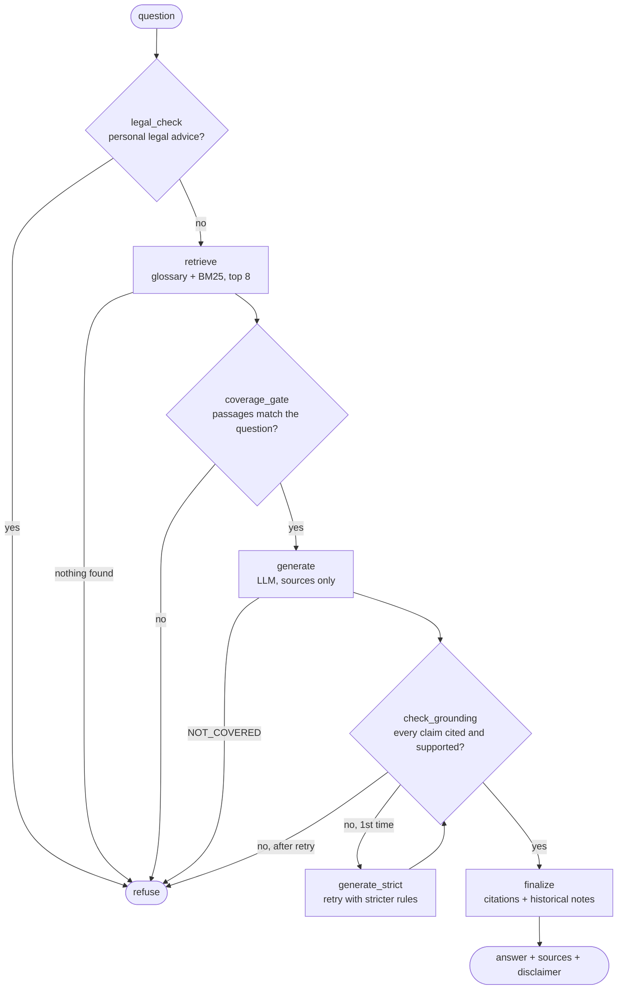

# Jobseeker Rules Assistant

Answers jobseekers' questions about Finnish rules and services (unemployment benefits,
side income, pay subsidy, work trial, training, the 2025 employment services reform)
using **only official public pages**, with a citation (URL + section) for every claim.
If the sources don't cover a question, it says so and points to Kela or the employment office.

> Not legal or official advice. Rules change — always check with Kela or your employment office.

The point of the project is the **evaluation**: showing the answers are correct, grounded in
the sources and safe. See `CLAUDE.md` for the rules and `PROGRESS.md` for status.

## How it works

Source pages are saved once (`make ingest`) as clean text with URL and fetch date. Every
question then runs through a LangGraph flow (`src/jobseeker_assistant/graph.py`):



- **No LLM call before the gates:** legal advice, nothing found and low coverage are refused first.
- **Grounding self-check** (`grounding.py`, in code): every sentence that states a fact must
  cite a source it was given; every number in it must appear in that source; most of its key
  words must too. One failure → one retry with stricter instructions and the failing
  sentences; a second failure → refuse.
- **Every refusal** says where to ask instead (Kela, employment services), and records why.

## Quick start

```bash
python3 -m venv .venv && . .venv/bin/activate
make install
make test                      # unit tests, never call a real LLM
make ingest                    # fetch missing snapshots (never overwrites)
cp .env.example .env           # add ANTHROPIC_API_KEY, or set LLM_PROVIDER=fake
make ask Q="Can I work part-time while unemployed?"
```

| Variable | Meaning | Default |
|---|---|---|
| `LLM_PROVIDER` | `anthropic` or `fake` (offline, no key) | `anthropic` |
| `LLM_MODEL` | model id | `claude-haiku-5-5` |
| `ANTHROPIC_API_KEY` | secret, only via env / `.env` | — |

`make refresh` re-fetches all snapshots (explicit, overwrites).

## Evaluation

`evals/golden.yaml` holds 35 questions with expected key facts and source URLs, or "must refuse";
it may be used for tuning. `evals/heldout.yaml` holds 15 more that are never used for tuning.
`make eval` runs both and saves a dated report per set in `evals/reports/` (fake LLM for now).
`make sweep` shows how the refusal cutoff trades off refusing off-topic questions against
answering real ones. Checks: refusal correct, expected source cited, key facts in the answer —
plus two diagnostics (expected source retrieved, key facts in the retrieved text).

## Glossary and legal-advice rule

`sources/glossary.toml` maps Finnish terms and everyday words to the English page wording
(palkkatuki → pay subsidy, side gig → part-time work). It only changes what is searched; each
entry says whether the page itself pairs the terms (`origin = "source"`) or it is our reviewed
mapping (`origin = "reviewed"` + `why`). Questions asking for personal legal advice ("should I
sue", "will I win my appeal") are refused before retrieval (`legal_advice.py`).

## Source tags

`sources/tags.toml` holds our reviewed decisions about pages, separate from the fetched text:
`status = "historical"` (+ `replaced_by`, `note`) for abolished rules, `audience = "employer"` for
pages written for employers, and `weight` (0 excludes a page). Historical pages rank lower, always
bring their replacement page along; when one is cited, the code adds the "replaced by" note and
cites the replacement. Identical passages on several pages are ranked once. Sections that are mostly links
(lines marked `[link]` at ingest) are excluded or down-weighted.
